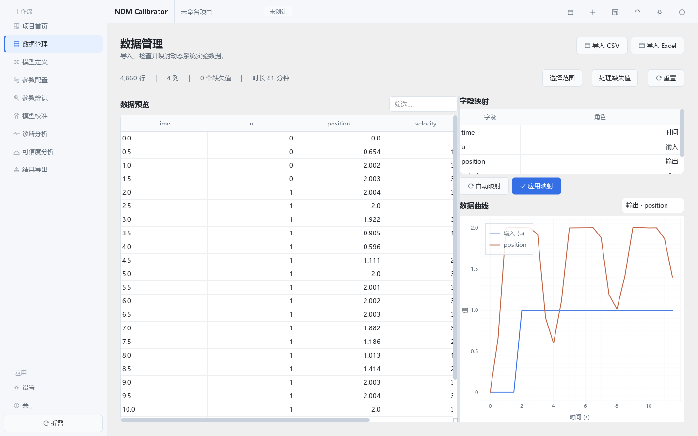
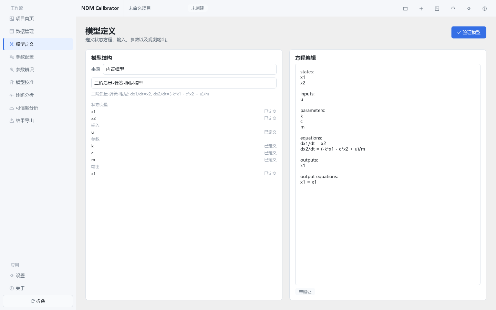
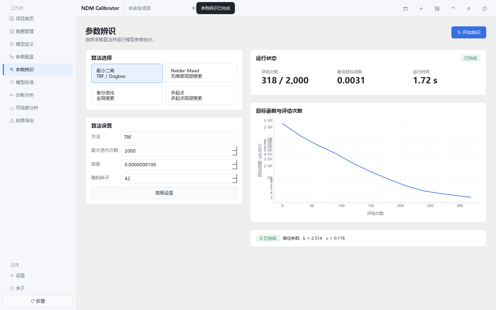
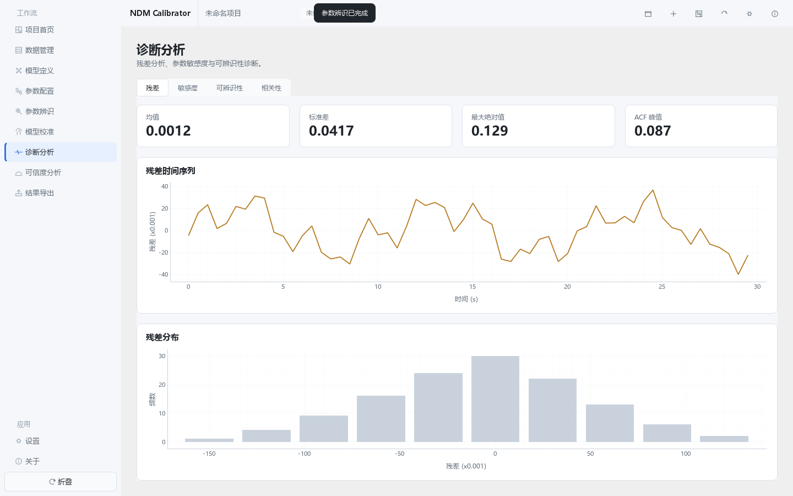

# NDM-Calibrator

**非线性动态模型参数辨识与校准软件**

*Nonlinear Dynamic Model Parameter Identification & Calibration Tool*

根据实验/观测时序数据，辨识用户自定义非线性动态模型中的未知参数，并给出校准质量与参数可信度分析。

---

## 这是什么

工程与科研中常见这样一类问题：你已经知道系统的**动态结构**（一组微分方程），但方程里的**参数未知**，只测到了一段带噪声的时序数据。NDM-Calibrator 就是解决这个问题的桌面工具：

```
实验数据 (time, u, x)  +  模型结构 (dx/dt = f(x, u, θ))  →  参数 θ 的估计值 + 可信度
```

它以**图形界面**完成完整工作流，不需要写代码：

```
新建项目 → 导入数据 → 定义模型 → 配置参数 → 运行辨识 → 查看诊断 → 评估可信度 → 导出报告
```

## 功能概览

| 环节 | 能力 |
| --- | --- |
| **项目管理** | 新建 / 打开 / 保存 `.ndmc` 项目格式（ZIP 容器，schema 1.0） |
| **数据导入** | CSV / XLSX，字段手动映射，数据质量检查与基础预处理 |
| **模型定义** | 5 个内置模型模板 + 用户自定义模型，SymPy 安全解析（**禁用 `eval`**） |
| **参数配置** | 表格式编辑器，边界校验，Free / Fixed 状态切换 |
| **数值求解** | `solve_ivp` 支持 RK45 / DOP853 / Radau / BDF；ZOH 与线性输入插值 |
| **参数辨识** | 非线性最小二乘、Nelder-Mead、Differential Evolution、Multi-start |
| **校准指标** | SSE / MSE / RMSE / MAE / R² / 最大绝对误差 / Mean Error |
| **诊断分析** | 残差统计与 ACF、参数敏感性、可辨识性（条件数 / 奇异值 / 相关矩阵） |
| **可信度分析** | Multi-start 稳定性、Residual Bootstrap 置信区间（percentile） |
| **结果导出** | Excel / CSV / 图片 / HTML 分析报告 |

### 两个界面

- `ui/` — 基于自研设计系统的 Fluent 风格 Qt 界面（V1.0 主体）
- `ui_v2/` — PyQt 高保真重构界面，按 DPI（100% / 125% / 150%）对齐 Web 原型视觉规范

> `python -m app.main` 当前启动的是 `ui_v2`。迁移过程与视觉审计结论见
> [docs/README_QT_MIGRATION.md](NDM_Calibrator/docs/README_QT_MIGRATION.md)。

## 界面截图

| 数据管理 | 模型定义 |
| --- | --- |
|  |  |

| 参数辨识 | 校准与残差诊断 |
| --- | --- |
|  |  |

完整界面截图见 [screenshots_qt/](NDM_Calibrator/screenshots_qt/)，
Web 原型参考见 [web-ui/](NDM_Calibrator/web-ui/)。

## 环境要求

- Windows 10/11（Linux / macOS 亦可运行）
- **Python 3.11+**
- 无需 GPU、无需 Docker、无需云服务器

## 安装

```powershell
cd NDM_Calibrator
python -m venv .venv
.\.venv\Scripts\activate
pip install -r requirements.txt
```

## 启动

```powershell
python -m app.main
```

Windows 下也可直接双击 `run.bat`（会自动检查 Python、按需创建虚拟环境并安装依赖）。

## 快速上手

仓库自带 4 组由固定随机种子生成的示例数据（真实模型 + 轻微噪声），
每组附 `metadata.json` 记录**真值**与**推荐算法**：

| 示例 | 模型 | 真实参数 | 推荐算法 |
| --- | --- | --- | --- |
| `exponential_decay` | 指数衰减 `dx/dt = -k·x` | k = 0.35 | least_squares |
| `first_order` | 一阶惯性 `dx/dt = (-x + K·u)/τ` | K = 2.5, τ = 6.0 | least_squares |
| `second_order` | 二阶弹簧阻尼 | k = 30, c = 2 (m = 1 固定) | least_squares |
| `cubic_nonlinear` | 非线性 `-a·x - b·x³ + c·u` | a = 0.5, b = 0.8, c = 1.2 | differential_evolution |

操作步骤：

1. 新建项目；
2. 数据管理 → 导入 `NDM_Calibrator/examples/first_order/data.csv`；
3. 映射字段为 `time / u / x`；
4. 选择内置模型「一阶惯性系统」；
5. 运行 `least_squares`；
6. 将辨识结果与 `metadata.json` 中的 `expected_range` 对比。

更多说明见 [examples/README.md](NDM_Calibrator/examples/README.md)；
重新生成示例数据：`python scripts\generate_examples.py`。

## 测试

```powershell
cd NDM_Calibrator
$env:QT_QPA_PLATFORM="offscreen"; python -m pytest tests tests_v2
```

测试套件覆盖核心数据结构、模型解析、数值求解、四种辨识算法、诊断指标、
不确定度分析以及 GUI 冒烟测试。

## 目录结构

```text
NDM_Calibrator/
├─ app/             应用层（入口 / 控制器 / 常量）
├─ core/            领域对象（项目 / 模型 / 参数 / 实验 / 目标函数）
├─ data/            数据导入 · 字段映射 · 校验 · 预处理
├─ simulation/      ODE 求解器 · 插值 · 模拟器
├─ identification/  参数辨识算法（LS / NM / DE / Multi-start）
├─ diagnostics/     校准指标 · 残差 · 敏感性 · 可辨识性
├─ uncertainty/     Bootstrap · 置信区间 · 稳定性
├─ export/          导出（Excel / CSV / 图片 / HTML 报告）
├─ ui/              V1.0 桌面界面（设计系统 / 组件 / 页面）
├─ ui_v2/           PyQt 高保真重构界面
├─ examples/        示例数据（含真值 metadata）
├─ tests/           测试套件  ·  tests_v2/  ui_v2 冒烟测试
├─ scripts/         示例生成 · 截图采集 · DPI 布局审计 · 打包
├─ reference/       视觉基准截图
├─ screenshots_qt/  成品界面截图
├─ web-ui/          React + TS Web 原型（视觉规范来源）
└─ docs/            项目文档
```

## 文档

| 文档 | 内容 |
| --- | --- |
| [ARCHITECTURE.md](NDM_Calibrator/docs/ARCHITECTURE.md) | 架构设计 |
| [USER_GUIDE.md](NDM_Calibrator/docs/USER_GUIDE.md) | 用户指南 |
| [MODEL_FORMAT.md](NDM_Calibrator/docs/MODEL_FORMAT.md) | 模型定义格式 |
| [ALGORITHMS.md](NDM_Calibrator/docs/ALGORITHMS.md) | 算法说明 |
| [TESTING.md](NDM_Calibrator/docs/TESTING.md) | 测试说明 |
| [CHANGELOG.md](NDM_Calibrator/docs/CHANGELOG.md) | 变更日志 |
| [README_QT_MIGRATION.md](NDM_Calibrator/docs/README_QT_MIGRATION.md) | Qt 重构迁移说明 |
| [QT_VISUAL_AUDIT.md](NDM_Calibrator/docs/QT_VISUAL_AUDIT.md) | 视觉审计报告 |
| [KNOWN_VISUAL_DIFFERENCES.md](NDM_Calibrator/docs/KNOWN_VISUAL_DIFFERENCES.md) | 已知视觉差异 |
| [WEB_REFERENCE_AUDIT.md](NDM_Calibrator/docs/WEB_REFERENCE_AUDIT.md) | Web 基准审计 |
| [NDM_Calibrator/README.md](NDM_Calibrator/README.md) | 应用内详细说明 |

## 技术栈

Python 3.11+ · NumPy · SciPy · pandas · SymPy · Matplotlib · openpyxl · PySide6 · pyqtgraph
（Web 原型：React + TypeScript + Tailwind + Recharts + Vite）

## 许可证

**本仓库尚未添加开源许可证（License）。**

在添加许可证之前，代码默认保留全部权利。若你希望他人可以自由使用、修改与分发，
建议补充一个明确的许可证文件，例如 [MIT](https://choosealicense.com/licenses/mit/)
或 [Apache-2.0](https://choosealicense.com/licenses/apache-2.0/)。
